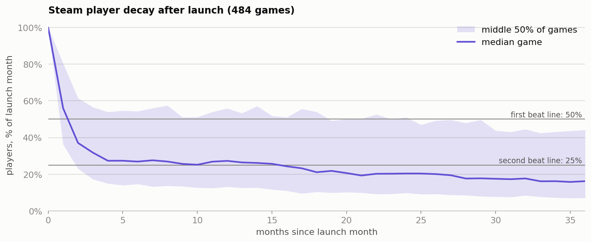

# Steam player decay: launch benchmarks and when to plan the first update

How fast do players leave after launch? Across 484 Steam games, the median game holds 56.0% of its launch-month players after one month and 37.1% after two, then flattens: 26.9% at month 6 and 27.3% at month 12. **The recommendation is to plan the first major update for month 2 at the latest, and to use these figures as launch benchmarks.** The timing is a planning rule, because this observational data can't show that an update at that point works. Launch size is too weak a predictor to plan on (Spearman rho −0.24).



**Read next:** [decision memo](case_study.md) (one page, for a studio head) · [analysis code](src/analysis.py) · [every number](out/results.json)

Decision rules are fixed at the top of [the analysis script](src/analysis.py), and each script stops if its data checks fail. This is independent analysis of public data, and isn't affiliated with any company or game named here.

## How to reproduce

```bash
python3 -m venv .venv && source .venv/bin/activate
```

```bash
pip install -r requirements.txt
```

```bash
tools/get_data.sh
```

```bash
python src/analysis.py
```

## Repo structure

```text
.
├── case_study.md        one-page decision memo
├── src/analysis.py      data checks, analysis, charts
├── src/gamestats.py     statistics helpers and chart style
├── tools/get_data.sh    downloads the source data (not redistributed)
├── out/                 results.json, charts, tables
└── data/                where the download goes
```

## Skills

Retention analysis · cohort analysis · bootstrap · rank correlation · Python

## More case studies

- [Cookie Cats gate A/B test](https://github.com/rahulkundanjha-blip/cookie-cats-ab-test)
- [Steam library activation](https://github.com/rahulkundanjha-blip/steam-library-activation)
- [League of Legends first 10 minutes](https://github.com/rahulkundanjha-blip/lol-first-10-minutes)
- [Lichess matchmaking and first-move fairness](https://github.com/rahulkundanjha-blip/lichess-matchmaking)

## Contact

KinetiArc
