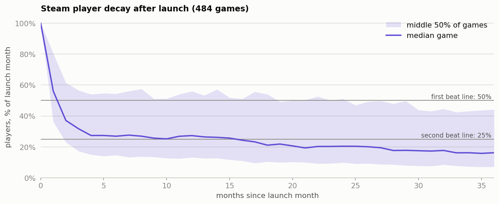

# Steam player decay: launch benchmarks and when to plan the first update

*Rahul Jha, KinetiArc. Independent analysis of public data; not affiliated with Valve or any game named here.*

## 1. Decision

**Plan the first major update for month 2 at the latest, because the median game has lost half its launch players by then, and judge your launch against the benchmarks below.** The timing is a planning rule rather than proof: this data shows when players leave, not whether an update would keep them.

## 2. What we looked at

Monthly average concurrent players for 1,258 Steam games, July 2012 to February 2021.
We followed the 484 games first tracked after the file starts, with at least 500 players in their launch month.

## 3. What happened

| Players, % of launch month | Month 1 | Month 3 | Month 6 | Month 12 | Month 24 |
|---|---|---|---|---|---|
| Top quarter of games starts at | 80.4% | 56.5% | 54.3% | 55.9% | 51.0% |
| **Median game** | **56.0%** | **31.8%** | **26.9%** | **27.3%** | **20.4%** |
| Bottom quarter of games starts at | 36.2% | 17.3% | 14.7% | 13.2% | 9.9% |

- **Decay comes in two phases:** about 31.8% a month over the first 3 months, then about 2% a month from month 12.
- **Second update:** the median falls below 25% at month 16 under the rule fixed in advance. It stays close to that line from month 6, so this date is soft.

## 4. Can we trust it?

- **What holds:** the month-2 result stays the same for games tracked 36+ months, launches of 2k+ players, and the 257 games whose release date I could confirm (34.2% at month 2). Only 1 game stops being tracked, so games disappearing doesn't distort this.
- **What doesn't:** the result depends on including the launch-month spike. Measured from the second month, the median takes until month 4 to halve. So "half gone by month 2" partly reflects launch excitement fading, not only players being lost.
- **Launch dates:** of 746 games matched to a release-date file, 58.3% were first tracked within a month of release and 38.9% earlier, probably early access. For those games, "launch" here means the first tracked month.
- **Launch size:** bigger launches keep less (37.0% at month 12 for 500–2k players, 17.6% for 10k+), but the correlation of −0.24 misses the 0.3 needed to plan on it.

## 5. What it means for the business

The first three months are the window that matters most. Monthly jumps of 50%+ are common but easy to overstate: 68.1% of games had one, falling to 41.9% when counting only games with 500+ players beforehand. For those, players three months later are 1.32 times the pre-jump level, against 0.90 after months with no jump, and 71.5% of the peak remains. We can't see the causes, such as updates, sales or free weekends, so this is a reason to test, not proof of payoff.

## 6. Next experiment

Hypothesis: giving players new content earlier keeps more of them to month 3. In a live game, randomise players to get the same update in week 6 or week 10. Metric: active at month 3. Guardrails: revenue per player and update completion. Sample size needs that game's own player data.

## 7. Limitations

- Monthly data can't separate week 6 from week 10 or show when a player left.
- Concurrent players aren't retained individuals, so a falling count mixes leaving and playing less.
- There is no price, genre, revenue or update data, so nothing here shows cause.
- The file may not cover every game, and its selection rules aren't documented, so benchmarks may lean towards games that did well.
- The 2019 launch group reached month 12 during the pandemic, and its range is wide (24.5% to 78.6%), so I don't lean on it.
